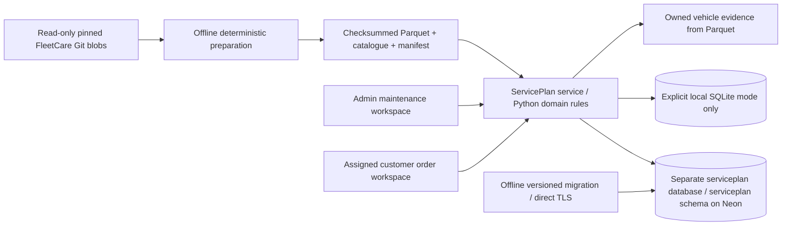

# Architecture

`app.py` calls `ui.main`; domain scheduling, catalogue, reporting, auth, service and storage live in `src/serviceplan`. No FleetCare import at runtime. All identifiers/config/session keys are ServicePlan specific. Backend role/ownership checks protect direct IDs, charts, queries and writes. The browser holds an opaque eight-hour token; the database holds its SHA256 digest. Passwords use salted PBKDF2-SHA256, 210,000 iterations, with persisted sign-in throttling. Sign-out revokes that session only. No globally cached customer data exists.

Hosted traffic uses psycopg with TLS, disabled prepared statements for pooling, transaction-local search path, 30-second statement/lock bounds, and a schema-specific transaction advisory lock to serialize state transitions. Idle read connections retry once. A stale connection before transaction body entry may reconnect once; body failures/uncertain commits are never replayed. Refresh/retry reconciles unique order/response IDs. An explicit local SQLite WAL adapter provides the same service semantics for offline demos/tests; failure never causes an automatic backend switch.

`001_serviceplan.sql` runs offline against a direct endpoint. Migration rejects non-ServicePlan database names/schema namespaces and unrelated existing schemas. Seed checks the manifest, skips an unchanged import, preserves occurrences and synthetic history with uniqueness constraints, and protects existing interactive orders on a reference refresh. Operational records are never regenerated at sign-in. Source history is explicitly synthetic; interactive feedback starts null. Reference imports log an evaluation record and audit event.

Reporting left-joins one order, response and qualifying completion to every occurrence. Task arrays live in response snapshots and keyed task rows; they are not joined unaggregated, preventing row multiplication. UI refresh reads the shared store. All filters operate on the complete result before pagination and CSV download. Only evidence for the selected owned vehicle is read from Parquet.

Boundaries: one portfolio dataset/clock, no general migration framework, catch-up automation, real notification receiver or inventory subsystem. Database role is the existing verified project owner; this delivery does not alter shared roles/global settings. Restrict portfolio demo accounts before using any non-fictional data. This application contains fictional data only.
